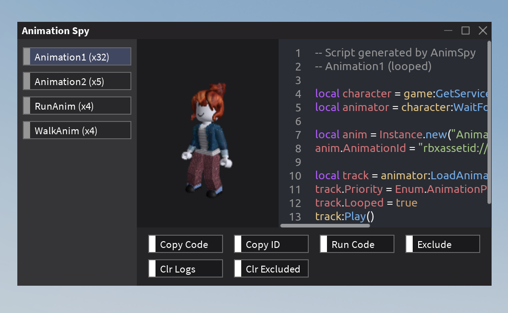

# AnimationSpy

A **SimpleSpy-style animation logger** for Roblox. Every animation your character plays shows up in a list with a live 3D preview and a ready-to-run replay script.



## Usage

```lua
loadstring(game:HttpGet("https://raw.githubusercontent.com/k7gi/AnimationSpy/refs/heads/main/main.lua"))()
```

## Features

- **Logs every animation** played on your character's `Animator`. It re-hooks on respawn.
- **One row per animation.** Repeats bump the row to the top with a play count (`RunAnim (x4)`) instead of spamming the list.
- **Live preview.** Your character is cloned into a `WorldModel` and plays the selected animation on loop while the camera orbits.
- **Replay script.** A syntax-highlighted script that plays the animation with its original `Priority` and `Looped` values.
- **Priority colorbar** on each row: yellow `Movement`, green `Idle`, purple `Action`, grey `Core`, red `Action2+`.
- **Pause logging** by clicking the title. On hover it shows green when logging is on and red when paused.

## Buttons

| Button | What it does |
| --- | --- |
| Copy Code | Copies the replay script |
| Copy ID | Copies `rbxassetid://<id>` |
| Run Code | Runs the replay script on your character |
| Exclude | Hides the animation and ignores future plays |
| Clr Logs | Clears the list |
| Clr Excluded | Clears the exclude list |

## Requirements

The executor needs `loadstring`, `game:HttpGet`, `setclipboard`, and the ability to parent to `CoreGui`.

>[!NOTE]
> The code highlighting comes from SimpleSpy's `highlight.lua`, fetched at startup. If the fetch fails, the codebox falls back to plain text.

## Credits
- [exxtremestuffs/SimpleSpySource](https://github.com/exxtremestuffs/SimpleSpySource) (GUI style and `highlight.lua`)
